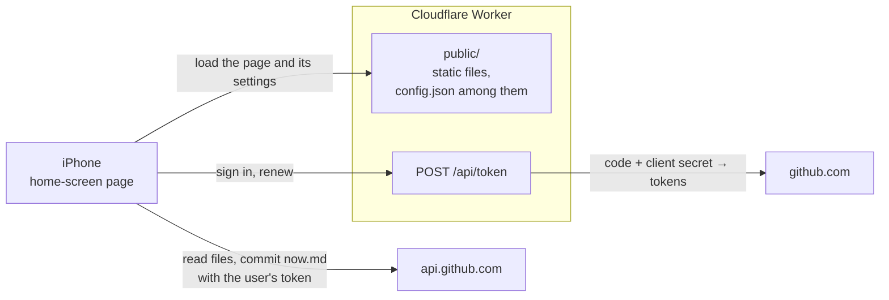
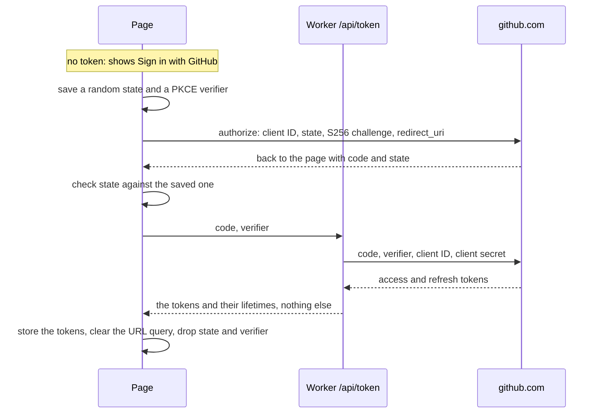
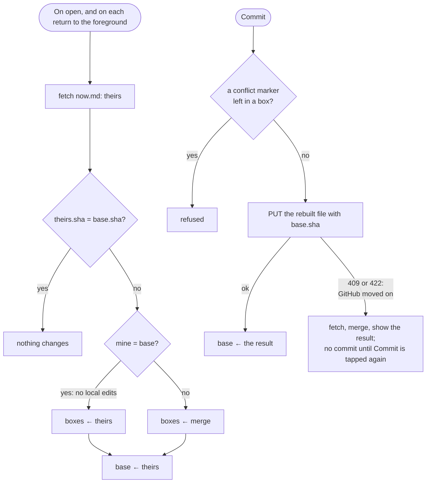

# Phone page — Design

## Purpose

A phone-friendly page, added to the iPhone home screen, for writing one notes file, `now.md`,
and reading the rest of a private GitHub repo. Each user signs in with their own GitHub login.
A phone companion to md-viewer: it renders markdown the same way, from GitHub instead of disk.

## Architecture



| Part | Does | Holds |
|---|---|---|
| Page (`public/`) | everything the user sees; calls `api.github.com` itself | in `localStorage`: the tokens, the `now.md` boxes, the file list |
| Worker (`worker/index.js`) | swaps a sign-in code or refresh token for tokens, the one step that needs the client secret | the client secret; no state, and tokens only while passing them on |
| GitHub | the repo, and who may read or write it | everything private |

Static files are answered by Cloudflare without running the Worker's code, and so is any path
that is neither a file nor `/api/token`: `wrangler.toml` sends only `/api/token` to the Worker
(`run_worker_first`), and the rest get `public/404.html` (`not_found_handling = "404-page"`).
Only `/api/token` counts toward the free plan's daily Worker requests.

## Settings

`public/config.json`, a static file the page fetches at start; the Worker imports the same file
for the client ID. Nothing about the repo or the App is in the page's code. A change needs a
deploy.

| Setting | | Meaning | When missing |
|---|---|---|---|
| `REPO` | required | the repo to read, `owner/name`; branch `main` | the page says what to set, instead of signing in |
| `GITHUB_CLIENT_ID` | required | the client ID of your GitHub App ([SETUP.md](SETUP.md)) | the same |
| `NOW_FILE` | optional | the repo path of the notes file, such as `notes/now.md` | only the Repo tab shows |

## Sign-in

GitHub App user authorization (the OAuth web flow with PKCE), once per phone.



`redirect_uri` is the page's own address (`location.origin` + `/`), so one code path works live
and on localhost; GitHub accepts it only if it is one of the App's callback URLs.

| Token | Lasts | Notes |
|---|---|---|
| Access | 8 hours | sent with every GitHub call |
| Refresh | 6 months | works once: each renewal returns a new pair |

Token expiry is GitHub's default for Apps and stays on.

| When | The page |
|---|---|
| The access token is within 5 minutes of expiring, before a GitHub call | renews: posts the refresh token to `/api/token`, stores the new pair |
| A GitHub call returns `401` | renews, then retries the call once |
| Two open copies of the page renew at once | one at a time, under a Web Lock; the second reads storage again and uses the pair the first got |
| Renewal fails (6 months unused, or revoked) | drops the tokens and shows **Sign in with GitHub**; the `now.md` boxes are kept |
| **Sign out** | clears the tokens on that phone; [revoking](SETUP.md#revoke-a-lost-phones-login) is separate |

## The page

| Tab | Route | Shows | Writable |
|---|---|---|---|
| **Now** | `#now`, the default | `NOW_FILE` as three text boxes, and Commit | yes |
| **Life** | `#life/<path>` | the folder holding `NOW_FILE`; opens on its `todo.md`, or on the folder without one | no |
| **Repo** | `#repo/<path>` | the whole repo | no |

- Routes are the URL hash, so the back button and links work. `?a=<id>` after a path scrolls to
  a heading.
- Tapping Life while in it goes back to `todo.md`; its first breadcrumb, the folder's name
  (`#life`), opens the folder.
- Without a `NOW_FILE`, Now and Life are hidden and their routes open Repo.
- The top bar is always shown: the tabs, then **‹ › ↻**, history back and forward and a full
  reload. The home-screen app has no browser buttons, and the reload is how it picks up a new
  deploy; it is safe, as the boxes are already saved.
- Buttons and links show a pressed look.

### Now

The file is a header, then three sections. The page shows only the sections, one box each, with
a one-line hint of what the box is for.

```markdown
# Now                               ← header: kept as it is, not shown

<!---------------------------->
## Todo inbox                       ← box 1
<!---------------------------->

- things to file

<!---------------------------->
## Other inbox                      ← box 2
<!---------------------------->

<!---------------------------->
## Mind                             ← box 3
<!---------------------------->
```

| Reading | Writing (Commit) |
|---|---|
| Split at the three headings, in any order | Header, then the headings in the order above |
| A missing heading reads as that section empty | Every heading is written, so a section can be emptied but not removed |
| A divider line (only `<!--`, dashes, `-->`) right above or below a heading is left out of the box | The canonical divider goes above and below each heading |
| Comments elsewhere stay in the box as typed | |

The dividers make the sections stand out in md-viewer's plain Edit textarea; the phone owns them.

Kept in `localStorage`:

| Key | Holds | Changes |
|---|---|---|
| `base` | the last `now.md` read from GitHub: its text and blob `sha` | on sync and after a Commit |
| `mine` | the three boxes | on every keystroke |



Merge is per section, between `base`, `mine` and `theirs`:

| `mine` | `theirs` | The box gets |
|---|---|---|
| unchanged | changed | theirs |
| changed | unchanged | mine |
| changed | changed, to the same text | that text |
| changed | changed differently | both, between `<<<<<<< phone`, `=======` and `>>>>>>> github` lines |

Writes are rare, so a whole-section conflict is simple enough.

- **Not committed**, in the warning color, and **Discard** show beside Commit while the boxes
  differ from `base` (ignoring whitespace at the ends). Discard takes two taps, the first arming
  it for 4 seconds, and resets the boxes to `base`.
- The commit goes to `PUT /repos/{owner}/{repo}/contents/{NOW_FILE}` with the message
  `<folder>: <file> from the phone`, or `<file> from the phone` at the repo root.

### Now's boxes

| Feature | Behaviour |
|---|---|
| Font | the system font, which fits about 30% more per line than monospace |
| Auto-grow | a box is as tall as its text, at least about 9 lines; the page scrolls, not the box |
| Links | under each box, the web links in its text, one per line, as a textarea can't hold links; one to the page's own address opens in place, so it works as a bookmark |
| Focus mode | focusing a box makes it fill the screen above the keyboard; only Commit, Discard and Not committed stay, below it. The heading row gains **Preview** and **Done**. Only Done leaves: a blur doesn't, so tapping Commit doesn't make the layout jump |
| Preview | in focus mode, renders the box's markdown as the Life tab does; **Edit** goes back. Tapping a task's checkbox flips that line's `[ ]` ↔ `[x]` in the text, and nothing else can be changed there |

Link labels say where a link goes:

| Link | Label |
|---|---|
| `#repo/notes/trips/2026-09.md` on the page's own address | `notes/trips/2026-09.md` |
| `#life/<path>` | the full repo path, Life's folder included |
| either, with `?a=<id>` | the path, then ` § <id>` |
| `#now` | `now` |
| anything else | host, path and hash, without the query |

### Life and Repo

| Data | From | Cached |
|---|---|---|
| File list | `GET /repos/{owner}/{repo}/git/trees/main?recursive=1` | in `localStorage` by tree `sha`; refreshed on open when `main` has moved |
| A file | `GET /repos/{owner}/{repo}/contents/{path}`, `Accept: application/vnd.github.raw` | no |
| A repo image in markdown | the same, shown as a `blob:` URL, since the repo is private | no |

| Listing | Rule |
|---|---|
| A folder | its `README.md`, if any, above the listing; never `AGENTS.md` in its place |
| Life | hides names starting with `_` or `.`, and `AGENTS.md` and `CLAUDE.md` |
| Repo | lists everything |

Markdown is rendered by markdown-it with raw HTML on, then sanitized ([Security](#security)).
Other files show as plain text.

| In the file | On the page | md-viewer differs |
|---|---|---|
| Raw HTML | what the sanitizer allows: `<details>`, `<br>`, `<kbd>`, `<sub>`, `<sup>` | |
| HTML comments | removed | |
| `[ ]`, `[x]` opening a list item | a disabled checkbox | |
| Tables | sort by tapping a header, empty cells last; `<!-- default-sort: <column> [asc\|desc] -->` above one sets how it opens | |
| H2–H6 | numbered `1.`, `1.1.`, … | `<!-- section-numbers: false -->` is not read |
| Two or more H2/H3 | a numbered **Contents** list after the H1, or at the top without one | starts collapsed |
| Heading ids | GitHub's, from the text without the number | |
| A link to a repo file | the page's own route: Life for a file in Life's folder, else Repo; a heading as `?a=<id>` | |
| A link elsewhere | opens in Safari | |
| An image from another host | loaded from it, at the file's `width` and `height`; in a table cell it keeps its width, and the table scrolls sideways | |
| `mermaid`, `plantuml`, `puml` fences | an image from mermaid.ink or plantuml.com, on a white card, with the source collapsed under **Diagram source**; if it fails to load, the source opens | Mermaid is drawn locally |
| Math | stays a code block | rendered |

The page holds no diagram library and inserts no SVG markup: a diagram is an `` whose URL
carries the encoded source, so both services see the diagram's text.

## Known limits

| Where | Limit |
|---|---|
| Preview's task toggle | a task inside a `>` quote or an HTML comment throws the checkbox count off |
| Images | raw HTML `` stays broken; only markdown-syntax images are fetched from the repo |
| Images | `style` is stripped, so `min-width` and the like are dropped |
| PlantUML | needs `CompressionStream("deflate-raw")`, iOS Safari 16.4 or later; a syntax error comes back as a picture of the error |
| Link labels | on `localhost`, a link to the deployed page counts as outside, and shows host and path |

## Security

How these layers work, and why: [docs/web-security.md](docs/web-security.md).

| Risk | What limits it |
|---|---|
| A stranger opens the page | nothing private is in it: everything comes from GitHub, as the signed-in user. `/config.json` is a public static file and not secret |
| A token leaks | the access token dies within 8 hours. The refresh token is good for 6 months, so a lost phone is [revoked](SETUP.md#revoke-a-lost-phones-login) |
| The token can do more than the page | it has contents read and write on the repos the App is installed on, so install it on the one repo. That only `now.md` is editable is the page's limit, not the token's |
| A repo file carries script | DOMPurify's allowlist, below; then the CSP, which blocks inline script even if the sanitizer misses something. Every script, the libraries included, is served from the Worker |
| A repo file carries a tracking pixel | accepted: `img-src` allows any `https:` host, for outside images and the diagram services. An `` can't run code or reach the page, and the host doesn't get the page's address (`no-referrer`), but it sees that someone asked. No proxy sits in between |
| Someone else calls `/api/token` | `POST` only, from no `Origin` or its own, with a JSON `code` and `code_verifier` or a JSON `refresh_token`. It returns only the tokens and their lifetimes, or GitHub's error name; a refused request gets a bare error, never anything it sent. Which status a refusal gets is up to the framework |
| An old deploy with a fixed bug stays reachable | preview URLs are off in `wrangler.toml`, so only the live version has an address |
| A bill | Cloudflare free plan, no card. Static files are free and unlimited; past the free daily Worker requests only sign-in and renewal stop, until the next day |

The sanitizer's allowlist:

| | Allowed |
|---|---|
| Tags | what markdown-it makes, plus `details`, `summary`, `br`, `kbd`, `sub`, `sup` |
| Attributes | `href`, `src`, `alt`, `title`, `id`, `class`, `target`, `rel`, `start`, `open`, `width`, `height`, `data-*` |
| On `input` | only `type`, `checked`, `disabled`; any `input` is forced to a disabled checkbox |
| Never | `style`, event handlers, `iframe`, `form`, `script` |
| Ids | prefixed `user-content-`, as on GitHub, so a heading can't shadow a page global |

The headers, on every file, from `public/_headers`:

```text
Content-Security-Policy: default-src 'self'; connect-src 'self' https://api.github.com;
  img-src 'self' blob: data: https:; style-src 'self'; script-src 'self';
  base-uri 'none'; form-action 'none'; frame-ancestors 'none'
Referrer-Policy: no-referrer
X-Content-Type-Options: nosniff
```

## Files

| Path | What |
|---|---|
| `wrangler.toml` | the Worker: its name, the static files, which path runs its code |
| `public/config.json` | the page's [settings](#settings) |
| `github-app.json` | the GitHub App's settings, as a manifest |
| `worker/index.js` | the Worker: `/api/token`, on Hono, with the body checked by Valibot |
| `public/index.html`, `style.css`, `manifest.webmanifest`, `icons/` | the page's shell and its home-screen icons |
| `public/app.js` | tabs, Now's sync and Commit, the Life and Repo views |
| `public/github.js` | sign-in, renewal and GitHub calls |
| `public/now.js` | Now's split, rebuild and merge, the task toggle and the link labels |
| `public/routes.js` | the hash routes and link resolving |
| `public/markdown.js` | markdown-it and the sanitizer, set up for the page |
| `public/diagrams.js` | the Mermaid and PlantUML image URLs |
| `public/config.js` | the settings, read from `/config.json` and checked |
| `public/_headers` | the security headers |
| `public/404.html` | the answer for any path that isn't a file or `/api/token` |
| `public/vendor/` | markdown-it and DOMPurify, copied from `node_modules` by `make vendor`, gitignored; loaded as plain scripts that set the globals `markdownit` and `DOMPurify` |
| `types/` | declarations for the type checker, such as those globals |
| `tests/` | Vitest, offline, with `fetch` stubbed; the markdown tests run under jsdom, since DOMPurify needs a DOM |
| `Makefile` | `dev`, `vendor`, `assets`, `lint`, `format`, `test`, `serve`, `deploy` |

The page is plain ES modules with no build step. Logic that can be a pure function is one (in
`now.js`, `routes.js`, `diagrams.js`), and is tested.
