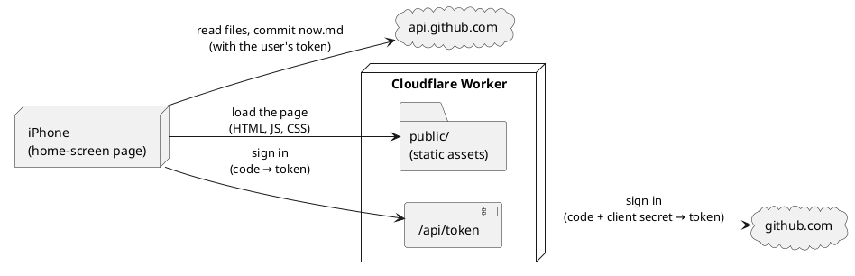

# Phone page — Design

## Purpose

A phone-friendly page, added to the iPhone home screen, for writing one notes file, `now.md`,
and reading the rest of a private GitHub repo. Each user signs in with their own GitHub login.
A phone companion to md-viewer: it renders markdown the same way, from GitHub instead of disk.

## Settings

The Worker's `[vars]` in `wrangler.toml`, which the Worker serves to the page as
`GET /config.json`. Nothing about the repo or the App is in the page's code.

| Setting | | Meaning |
|---|---|---|
| `REPO` | required | the repo to read, `owner/name`; branch `main` |
| `GITHUB_CLIENT_ID` | required | the client ID of your GitHub App (see [Setup](#setup)) |
| `NOW_FILE` | optional | the repo path of the `now.md` file, such as `notes/now.md` |

- Missing `REPO` or `GITHUB_CLIENT_ID`, the page shows which to set instead of signing in.
- With `NOW_FILE`, all three tabs show, and Life is the folder holding the file. Without it,
  only Repo shows, and the page opens on it.

## Architecture



- One Cloudflare Worker, deployed with Wrangler from `wrangler.toml`. It serves `public/` as
  static assets, which Cloudflare answers without running the Worker's code. Its code serves
  `GET /config.json` (the [settings](#settings)) and `POST /api/token`, the one step a browser
  can't make itself, because it needs the App's client secret: at sign-in, and every 8 hours to
  renew the token.
- Otherwise the page talks to `api.github.com` directly. The Worker sees tokens only while
  passing them on and keeps no state.
- The page holds no data of its own. Everything private comes from the repo through the
  signed-in user's GitHub access.

## Files

- `DESIGN.md`: this file, the source of truth. `README.md`. `AGENTS.md`: dev notes.
  `CHANGELOG.md`. `LICENSE`.
- `mise.toml`: the Node version. `package.json`, `package-lock.json`: the JS tools and
  libraries, pinned.
- `Makefile`: `dev`, `assets`, `lint`, `format`, `test`, `serve` (local dev), `deploy`. `biome.json`
  (lint and format, JS and JSON only, skipping `.wrangler/`, which `make serve` fills) and `tsconfig.json` (type checks of the plain JS).
- `wrangler.toml`: the Worker's settings, the page's [settings](#settings) among them.
  `github-app.json`: the GitHub App's settings, as a manifest.
- `worker/index.js`: the Worker's code.
- `public/`: the page, plain ES modules with no build step:
  - `index.html`, `style.css`, `manifest.webmanifest` and the home-screen icons in `icons/`.
    `.assetsignore` keeps a source repo's binary-folder files there from being served.
  - `app.js`: tabs, Now's sync and Commit, the Life and Repo views.
  - `github.js`: sign-in, renewal and GitHub calls. `now.js`: Now's split, rebuild and merge.
    `routes.js`: the hash routes and link resolving. `markdown.js`: markdown-it set up for the
    page. `config.js`: the settings, read from `/config.json`.
  - `_headers`: the security headers, and `vendor/` (library files copied from `node_modules`
    by `make vendor`, run by `make dev` and `make deploy`, gitignored): markdown-it and
    DOMPurify, loaded as plain scripts that set the globals `markdownit` and `DOMPurify`.
- `types/`: type declarations for the checker, such as the `markdownit` and `DOMPurify` globals.
- `tests/`: Vitest tests, offline: Now (with a sample `tests/now.md`), settings, routes,
  markdown and the Worker, with `fetch` stubbed. The markdown tests run under jsdom, since
  DOMPurify needs a DOM.

## Sign-in

GitHub App user authorization (OAuth web flow), once per phone:

1. The page has no token, so it shows **Sign in with GitHub**. Tapping it saves a random
   `state` and a PKCE verifier in `localStorage` and goes to
   `github.com/login/oauth/authorize` with the App's client ID, the state, the S256
   challenge, and `redirect_uri` set to the page's own address (`location.origin` + `/`). One
   code path then works live and on localhost; GitHub accepts it only if it is one of the App's
   callback URLs.
2. The user approves the App once. GitHub sends the phone back to the page with `code` and
   `state`.
3. The page checks `state` against the saved one, then posts `code` and the verifier to
   `/api/token`.
4. The Worker exchanges them at `github.com/login/oauth/access_token` with the client ID and the
   client secret (a Wrangler secret) and returns only the tokens and their lifetimes.
5. The page stores them in `localStorage`, clears the query from the URL, and drops the state
   and verifier.

Token expiry is on, GitHub's default for Apps. The access token lasts 8 hours; the refresh token
lasts 6 months and is replaced each time it is used.

Renewal:

- Before a GitHub call, if the access token is within 5 minutes of expiring, or after a call
  returns `401`, the page posts `{"refresh_token": …}` to `/api/token`. The Worker exchanges it
  with `grant_type=refresh_token` and the client secret and returns the new pair, which the page
  stores. The failed call is retried once.
- Only one renewal runs at a time across the page's open copies, under a Web Lock
  (`navigator.locks`). After taking the lock the page reads storage again and uses the new pair
  if another copy has already renewed it: a refresh token works once, so a second renewal with
  the old one would fail.
- If renewal fails (the refresh token expired after 6 months unused, or the login was revoked),
  the page drops the tokens and shows **Sign in with GitHub**. The `now.md` boxes are kept.

**Sign out** clears the tokens on that phone. Revoking a login is in
[Setup](#revoke-a-lost-phones-login).

## The page

Three tabs, routed by the URL hash, so the back button and links work:

- **Now** (`#now`, the default): the `NOW_FILE` as three text boxes, Todo inbox, Other inbox, then
  Mind, each with a one-line hint of what it is for, and Commit. Under
  each box, a row of tappable links lists the web links in its text, as a textarea can't hold
  links itself; a link to the page's own address opens in place, so it works as a bookmark.
- **Life** (`#life/<path>`): the folder holding the `NOW_FILE`, read-only. The tab opens on
  `todo.md` (`#life/todo.md`), and so does tapping it while in it, or on the folder when it has
  no `todo.md`; the first breadcrumb, the folder's name (`#life`), opens the folder.
- **Repo** (`#repo/<path>`): the whole repo, read-only.

Without a `NOW_FILE`, Now and Life are hidden, and their routes open Repo.

### Now

`now.md` is split at its `## Todo inbox`, `## Other inbox` and `## Mind` headings, in any order.
The text before the first is the header (title and legend), kept as it is and not shown. On
Commit the file is rebuilt as the header, then each heading followed by its box, in that order,
so a section can be emptied but its heading always comes back. A file missing a heading reads as that section empty.

Each section heading sits between two divider lines, `<!---------------------------->`, so the
sections stand out in md-viewer's plain Edit textarea. The phone owns them: a divider (a line
holding only `<!--`, dashes and `-->`) directly above or below a section heading is left out of
the boxes, and the rebuilt file always has the canonical divider above and below each heading.
Comments elsewhere stay in the boxes as typed.

Kept in `localStorage`:

- `base`: the last `now.md` read from GitHub, its text and blob `sha`.
- `mine`: the three boxes, saved on every keystroke. A box missing from an older `mine` reads
  as empty.

Uncommitted edits: while the boxes differ from `base` (ignoring whitespace at the ends), a
**Not committed** mark in the warning color and a **Discard** button show beside Commit.
Discard takes two taps (the first arms it for 4 seconds) and resets the boxes to `base`.

Sync:

- **On open**, and each time the page comes back to the foreground, it fetches `now.md`. If its `sha` matches `base`, nothing changes. If not:
  with no local edits (`mine` equals `base`), the boxes take the new file; with local edits,
  the page merges (below). Either way `base` becomes the new file.
- **Commit** writes the rebuilt file with `PUT /repos/{owner}/{repo}/contents/{NOW_FILE}`
  and `base.sha`, with the message `<folder>: <file> from the phone`, such as
  `notes: now.md from the phone` (just `<file> from the phone` at the repo root). On success the result becomes `base`. A `409` or `422` means GitHub moved on:
  the page fetches, merges, shows the result and does not commit; the user fixes it and taps
  Commit again.

Merge, per section, between `base`, `mine` and `theirs`: a section changed on one side only
takes that side; changed on both sides to the same text takes it; changed differently, the box
shows both:

```text
<<<<<<< phone
(my text)
=======
(GitHub's text)
>>>>>>> github
```

Writes are rare, so a whole-section conflict is simple enough. Commit is refused while a box
still contains a marker line. The split, rebuild and merge are pure functions in
`public/now.js`, tested in `tests/`.

### Life and Repo

- The file list comes from `GET /repos/{owner}/{repo}/git/trees/main?recursive=1`, cached in
  `localStorage` by tree `sha` and refreshed on open when `main` has moved.
- A file is fetched with `GET /repos/{owner}/{repo}/contents/{path}` and
  `Accept: application/vnd.github.raw`. Images in markdown are fetched the same way and shown as
  `blob:` URLs, since the repo is private.
- Markdown is rendered by markdown-it with raw HTML on, and the result is sanitized by
  DOMPurify (see [Security](#security)). So `<details>` toggles, `<br>` in table cells, `<kbd>`,
  `<sub>` and `<sup>` work as on GitHub. `[ ]` and `[x]` opening a list item become disabled
  checkboxes, read-only. HTML comments are removed before rendering, after reading
  `<!-- default-sort: <column> [asc|desc] -->` for the table that follows. Tables sort by tapping a header, with empty cells last, as in md-viewer.
- Links between repo files are rewritten to the page's own routes; links outside open in
  Safari. Headings get GitHub's ids, prefixed `user-content-` by the sanitizer as on GitHub, and a link
  to one is routed as `#repo/<path>?a=<id>`, the id without the prefix. As in md-viewer, H2–H6
  are numbered at render time (`1.`, `1.1.`, …), always (md-viewer's
  `<!-- section-numbers: false -->` is not read); ids come from the text without the number.
  With two or more H2/H3 headings, a **Contents** list of them, numbered, links to each and goes
  after the H1 (or at the top without one); unlike md-viewer it starts collapsed. A
  file inside Life's folder stays in the Life tab; anything else opens in Repo. Mermaid and math stay as code blocks. Other files show as plain text.
- A folder shows its `README.md`, if any, above its listing; `AGENTS.md` is never shown in its
  place.
- The Life listing hides code and agent files: names starting with `_` or `.`, and `AGENTS.md`
  and `CLAUDE.md`. They stay reachable from Repo, which lists everything.

## Security

- **Token**: a GitHub App user token with contents read and write, on the repos the App is
  installed on (install it on the one repo) that the user can already reach. It and its refresh token live
  in the phone's `localStorage`. An access token alone that leaks dies within 8 hours; the
  refresh token is good for 6 months, so a lost phone is revoked as in Setup. Only `now.md` is
  editable, but the limit is the page's, not the token's.
- **No foreign script**: markdown's HTML output, raw HTML from the repo included, goes through
  DOMPurify with an allowlist: the tags markdown-it makes, plus `details`, `summary`, `br`,
  `kbd`, `sub` and `sup`; attributes `href`, `src`, `alt`, `title`, `id`, `class`, `target`,
  `rel`, `start`, `open` and `data-*`, and on `input` only `type`, `checked`, `disabled`. Any
  `input` is forced to a disabled checkbox. No `style`, no event handlers, no `iframe`, `form`
  or `script`. Ids get the `user-content-` prefix, so a heading can't shadow a page global. As a
  second layer, `public/_headers` sends a Content Security Policy on every file, which blocks
  inline script even if the sanitizer misses something:
  `default-src 'self'; connect-src 'self' https://api.github.com; img-src 'self' blob: data:;
  style-src 'self'; script-src 'self'; base-uri 'none'; form-action 'none';
  frame-ancestors 'none'`, plus `Referrer-Policy: no-referrer`. Every script, the libraries
  included, is served from the Worker.
- **Worker**: holds the client secret; `/config.json` returns only the three settings;
  `/api/token` accepts only `POST` with a JSON `code` and
  `code_verifier`, or a JSON `refresh_token`, from no `Origin` or its own, and returns only the
  tokens and their lifetimes, or GitHub's error name.
- **Only the live version**: preview URLs are off in `wrangler.toml`. Left on, every deploy
  stays reachable at its own `<version>-<worker>.<subdomain>.workers.dev`, so a version with a since
  fixed bug could still be opened.
- **Cost**: Cloudflare free plan, no card on the account. Static asset requests are free and
  unlimited; past the free daily Worker requests only sign-in and renewal stop, until the next
  day.
- **Privacy** comes from GitHub: without access to the repo, a login sees nothing. The
  settings in `/config.json` are not secret: anyone can read them.

## Setup

Each deployment is its own: your Cloudflare account, your GitHub App, your repo. The App's
client ID is public; its client secret is a Wrangler secret and never goes in the repo. A
source repo may keep a record of what it set up, as this one's `DEPLOYMENT.md`.

### Secrets

A secret the Worker needs is copied into it with `wrangler secret put <NAME>` and read in code
as `env.<NAME>`, like the plain values in `wrangler.toml`'s `[vars]`. For `wrangler dev`, it
goes in `.dev.vars` (gitignored). Today that is just `GITHUB_CLIENT_SECRET`. Keep it in a
password manager; GitHub shows it once.

### Steps

1. **Cloudflare**: sign up at dash.cloudflare.com, no card. Workers & Pages → pick the
   `workers.dev` subdomain. Then `mise exec -- npx wrangler login` once on the laptop. Set the
   Worker's `name` in `wrangler.toml`, and put its URL,
   `https://<name>.<subdomain>.workers.dev/`, in `github-app.json`.
2. **GitHub App**: create it from `github-app.json` with GitHub's manifest flow. A form posts the
   manifest to `github.com/settings/apps/new`; one click on Create, then GitHub redirects to
   the Worker with a `code`. The App exists only once the code is converted, within the hour:
   `gh api -X POST /app-manifests/<code>/conversions --jq '{id, slug, client_id}'`, which
   prints only those and drops the secrets in the response. (Or fill in the same settings by
   hand at Settings → Developer settings → GitHub Apps → New.) Put the client ID in
   `wrangler.toml` as `GITHUB_CLIENT_ID`, and leave Optional features → user-to-server token
   expiration on. Install it from `github.com/apps/<name>/installations/new` → Only select
   repositories → your repo.
3. **Settings**: `REPO` and, if you want the Now and Life tabs, `NOW_FILE` in `wrangler.toml`.
   The file's format is in [Now](#now); a missing heading reads as empty, so it can start
   empty.
4. **Secret**: in the App's Credentials, Generate a new client secret, then, in this folder, `mise exec -- npx wrangler secret put GITHUB_CLIENT_SECRET` and paste it; if the
   Worker doesn't exist yet, answer yes to creating it. To replace it later, do the same again.
5. `make dev`, then `make deploy`.
6. **Other users**: add them as collaborators on the repo, with write access for Commit.
7. **Each iPhone**: open the Worker's URL in Safari, Share → Add to Home Screen, open it from the
   icon, Sign in with GitHub, approve the App.

GitHub App settings, from `github-app.json` except where noted: public, so other users can
sign in with it (they still see only repos they can reach, where it is installed); permissions
Contents read and write (Metadata read comes with it), nothing else; callback URLs the Worker's
URL and `http://localhost:8787/` (for [Local dev](#local-dev)); no webhook; no OAuth request
during installation; user-to-server token expiry on (GitHub's default; not in the manifest).

### Local dev

To try the page on the laptop before deploying:

- `make serve` runs `wrangler dev` (after `make vendor`): the page and `/api/token` at
  `http://localhost:8787`, with the code from the working tree. Stop it with Ctrl-C.
- The Worker's secret comes from `.dev.vars` (gitignored), one line
  `GITHUB_CLIENT_SECRET=...`: the same App and secret as live, so there is nothing extra to
  keep in sync. Agents don't read or print it. A line there such as `NOW_FILE=` overrides a
  setting for local dev only.
- Sign-in works because `http://localhost:8787/` is a callback URL of the App and the page sends
  its own address as `redirect_uri`. A login made on localhost is a real one, with the same
  access as on the phone, and its tokens live in the laptop browser's `localStorage` for
  `localhost:8787`.
- A Commit from localhost writes the real `NOW_FILE` on GitHub, as from the phone.

### Revoke a lost phone's login

The owner of the lost phone opens GitHub → Settings → Applications → Authorized GitHub Apps →
the App → Revoke. That ends every login of theirs to the App, so they sign in again on their
other phones. The lost phone's tokens, refresh token included, stop working, and signing in
again there needs their GitHub password. To shut out everyone at once, suspend or delete the App in its settings.
